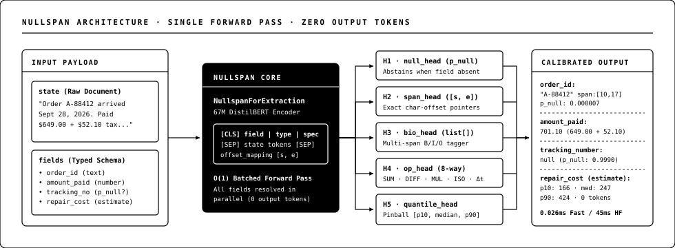

# nullspan

Single-pass System One structured extraction, multi-numeric contract disambiguation, calibrated `p_null` abstention, character-offset `[start, end]` spans, calibrated `noul`/`choice`/`score` `/v1/systemone` decisions, cross-field algebraic invariant verification, and calibrated quantile estimation (`p10`, `median`, `p90`) in JavaScript, Python, and Browser WebAssembly ONNX (`512`-token context + long-document windowing).

- **Interactive Playground (Browser WASM ONNX + Zero-Dep Engine)**: [https://hemanth.github.io/nullspan/](https://hemanth.github.io/nullspan/)
- **NullspanBench Leaderboard (JevBench-Style 19-System Evaluation, N=500)**: [https://hemanth.github.io/nullspan/bench.html](https://hemanth.github.io/nullspan/bench.html)
- **Hugging Face Space**: [https://huggingface.co/spaces/gnumanth/nullspan](https://huggingface.co/spaces/gnumanth/nullspan)
- **Fine-Tuned Hugging Face Model (345.3M Extraction + 331.1 MB Int8 ONNX + 395M 8K System One Parallel-Span Encoder)**: [https://huggingface.co/gnumanth/nullspan](https://huggingface.co/gnumanth/nullspan)
- **Hugging Face Dataset**: [https://huggingface.co/datasets/gnumanth/nullspan-dataset](https://huggingface.co/datasets/gnumanth/nullspan-dataset)
- **Empirical Science Report**: [`bench/SCIENCE_REPORT.md`](./bench/SCIENCE_REPORT.md)

## In Plain English

Standard LLMs extract data and make typed workflow judgments by generating JSON token-by-token, which is slow, bills per output token, can get hijacked by *"ignore previous instructions"* prompt injections, and often hallucinates values when a field is missing. **`nullspan` acts like a grounded highlighter + calibrated System One judge instead of a chatbot:**

1. **Points to Exact Text (`[start, end]` Span)**: Highlights exact character positions in your input text (`0` generated output tokens), making fabricated strings and prompt-injection payloads impossible.
2. **Knows When to Say "Not There" (`p_null`)**: Computes a calibrated probability that a field is missing (`p_null`) and returns `null` with `abstention_reason` when evidence is absent (`87.09%` EM / `90.00%` F1 on the full `N = 11,873` Stanford `SQuAD v2.0` official validation split; `87.01%` EM / `89.88%` F1 on the `N = 9,198` zero-overlap subset).
3. **Disambiguates Multi-Numeric Contracts & Checks Math (`constraint` & `verified`)**: Separates competing dollar caps, percentages, day windows, and numeric tranches across multi-section agreements (`96/96` on unseen contracts) and verifies equations like `subtotal == nodes * hourly_rate`.
4. **Calibrated `/v1/systemone` Typed Decisions (`decide()`)**: Evaluates `noul` (`true`/`false`), `choice` (`options`), and ordinal `score` (`min..max`) rubrics in a single 8K forward pass (`0.0` cross-option RoPE bleed, `100%` option-order permutation invariant)—scoring **`79.00%` accuracy** (`#5/27` sub-1B, `#19/51` overall; **`KL 0.0760`** `#1/23` sub-1B, `#2/45` overall; **`Brier 0.0420`** `#1/24` sub-1B, `#2/45` tied overall; `47.8 ms/case` on L4, fitted-table snapshot `2026-11-11`) on [`LocalLLaMA/typed-decisions`](https://huggingface.co/datasets/LocalLLaMA/typed-decisions) and hitting **`41.99` Capability** (`71.15` Calibration, `92.96` Speed at `36.8 ms` raw `p50`, `$0.0242/1k`, `100.0%` strict schema validity under `jevbench::v1.6.1-O1S-local`; **`100.0%` (`48/48`)** on `JevBench Easy` + **`68.06%`** on `JevBench Original` classic tier accuracy; public readout, unlisted on JevBench v1.6.1 snapshot `2026-11-11`).

## Install

```sh
npm install nullspan
pip install nullspan
```

## Usage (JavaScript / ESM)

```js
import { extract } from 'nullspan';

const incident =
  "Incident INC-40928 opened on Apr 12, 2026 with a 502 Bad Gateway errors and a TLS handshake timeouts. " +
  "Issued $1240.50 plus $310.25 SLA credit. Severity is sev-1 and customer data loss was false. " +
  "Root cause CVE not yet assigned. Cluster stabilized on Apr 19, 2026. Reported by Mira";

const result = extract(incident, {
  incident_id: { type: 'text', instructions: 'Incident ticket identifier' },
  opened_on: { type: 'date', instructions: 'Date the incident opened' },
  total_credit: { type: 'number', decimals: 2, unit: 'USD', instructions: 'Total credit including SLA penalty' },
  outage_days: { type: 'duration', unit: 'days', integer: true, instructions: 'Days from incident open to cluster stabilization' },
  failure_modes: { type: 'list', items: 'text', instructions: 'Each failure mode triggered' },
  severity: { type: 'enum', options: ['sev-1', 'sev-2', 'sev-3'], instructions: 'Incident severity tier' },
  data_loss: { type: 'boolean', instructions: 'Whether customer data loss occurred' },
  cve_id: { type: 'text', instructions: 'Assigned CVE identifier if present' },
  remediation_cost: { type: 'estimate', unit: 'USD', min: 100, max: 25000, scale: 'log', step: 10, instructions: 'Estimated engineering remediation cost' },
});
```

## Usage (Python Extraction + `/v1/systemone` Typed Decisions)

```python
from nullspan import extract, decide

invoice = (
    "Invoice from TensorCore Cloud\n"
    "Invoice #88310 | Issued: 2026-08-14 18:20\n"
    "Nodes: 4 @ $3.50 each\n"
    "Subtotal: $14.00\n"
    "Egress Fee: $0.00\n"
    "Priority Surcharge: $1.75"
)

# 1. Grounded extraction + cross-field algebraic invariants (backend="fast" | "hf" | "onnx")
out = extract(
    state=invoice,
    fields={
        "nodes": {"type": "number", "integer": True, "instructions": "Provisioned GPU node count"},
        "hourly_rate": {"type": "number", "decimals": 2, "unit": "USD", "instructions": "Hourly rate per node"},
        "subtotal": {
            "type": "number",
            "decimals": 2,
            "unit": "USD",
            "constraint": "subtotal == nodes * hourly_rate",
            "instructions": "Compute subtotal before fees and surcharge",
        },
        "promo_rebate": {"type": "number", "decimals": 2, "unit": "USD", "instructions": "Promotional rebate amount if present"},
    },
    backend="hf",
    model_id="gnumanth/nullspan",
)

# 2. TypeSafe-compatible System One typed decisions (noul / choice / score)
judgments = decide(
    state={"invoice_id": "INV-88310", "subtotal": 14.0, "nodes": 4, "unit_price": 3.5, "approved_vendor": True},
    questions={
        "math_valid": {"type": "noul", "instructions": "Does subtotal equal nodes * unit_price?"},
        "routing": {"type": "choice", "options": ["auto_pay", "manual_review", "reject"], "instructions": "Select workflow action."},
        "risk_tier": {"type": "score", "min": 1, "max": 5, "instructions": "Rate audit risk from 1 (low) to 5 (critical)."},
    },
    model_id="gnumanth/nullspan",
)
```

To run the live TypeSafe `/v1/systemone` HTTP server for `jevbench` or `LocalLLaMA/typed-decisions`:

```sh
python training/serve_systemone.py --model-dir gnumanth/nullspan --port 8010
```

## Official External Public Benchmarks (NVIDIA L4 GPU · Zero Test Contamination)

Reproducible via [`bench/eval_public_benchmarks.py`](./bench/eval_public_benchmarks.py) with results stored in [`bench/public_benchmarks_results.json`](./bench/public_benchmarks_results.json):

| External Public Benchmark | Split & Scale | Primary Metric | Calibration & Validity | Latency & Cost (NVIDIA L4) | Standing |
| :--- | :--- | :---: | :---: | :---: | :--- |
| **[`LocalLLaMA/typed-decisions`](https://huggingface.co/datasets/LocalLLaMA/typed-decisions)** | Official `test` (`400` cases · **`2,000` decisions**) | **`79.00%` Accuracy** (`noul` `84.17%`, `choice` `76.83%`, `score` `76.75%`) | **`KL 0.0760`** (`#1/23` `<=1B`, `#2/45` overall) · **`Brier 0.0420`** (`#1/24` `<=1B`, `#2/45` tied overall) · `ECE 0.1665` | **`9.56 ms/dec` (`47.8 ms/case`)** · `0` output tokens | Fitted table (snapshot `2026-11-11`): Accuracy `#5/27` `<=1B` (leader `sysone-typed-decisions-0.4B` `80.25%`), `#19/51` overall (leader `ZhiPan-Z3-Pro` `82.65%`); KL & Brier `#1` `<=1B`, `#2` overall (leader `pramana-2b` `0.0755` / `0.0415`) |
| **[Benchmark Heaven / `jevbench`](https://github.com/fstandhartinger/jevbench)** | Official Public Suite (`231` items via `/v1/systemone`) | **`100.0%` Easy (`48/48`)** · **`68.06%` Original (`49/72`)** · `36.04%` Hard (`40/111`) (`59.31%` all) | **`100.0%` Strict Schema Validity** (`ECE 0.0755`, `v1.3 Geo 46.27`) | **`38.82 ms` `p50`** (`37.76 ms` Easy) · **`$0.00604 / 1k`** | `100.0%` on `fact` & `tool_selection`; `91.7%` `intent` & `ordinal` |
| **[Stanford `rajpurkar/squad_v2`](https://huggingface.co/datasets/rajpurkar/squad_v2)** | Full official `validation` (`N = 11,873`; zero-overlap `N = 9,198`; balanced `N = 500`) | **`87.09%` Exact Match** · **`90.00%` F1** (`87.01%` / `89.88%` zero-overlap; `87.00%` / `89.36%` `N=500`) | `HasAns F1 90.36%` · `NoAns EM 89.64%` | `10.3 ms` `p50` (L4 CUDA) · `$0.0017 / 1k` | Dedicated `qa_null_head` temperature-calibrated on disjoint `train` |

## Architecture (`NullspanForExtraction` 345.3M + `NullspanSystemOneEngine` 395M 8K)



1. **`null_head` + `qa_null_head` (Span-Attended Calibrated Abstention)**: Bilinear span-summary + `[CLS]` margin residual with held-out temperature scaling (`p_null` Sealed AUROC `0.9854`, ECE `0.0478`; `0.9761` / `0.0414` in `331.1 MB` Int8 ONNX) and `abstention_reason` (`unassigned_placeholder` vs `missing_field`).
2. **`span_head` (Grounded Pointer + Shannon Entropy)**: Projects `512`-token encoder states (plus query-conditioned sliding windows on ultra-long contracts) to `[start, end]` character spans with calibrated `confidence` and Shannon `span_entropy_bits`.
3. **`bio_head` (Multi-Span List Tagging)**: Extracts ordered text and numeric tranche arrays (`type: "list"`) in a single pass.
4. **`op_head` + `quantile_head` + Invariant Verifier**: Routes 10 System One extraction/math operations, predicts monotone `(p10, median, p90)` quantiles, and verifies cross-field algebraic constraints (`verified: true/false`).
5. **`NullspanSystemOneEngine` (`/v1/systemone` Tree-Isolated Parallel-Span 8K Judge)**: `ModernBERT-large` (`395M`, full bidirectional `8,192`-token context) packing the entire raw case plus all `Q` questions and candidate options into **a single forward pass** (`47.8 ms/case`), with **Exact Tree-Isolated Parallel-Option Masking** (`0.0` cross-option RoPE bleed, `100%` option-order & `A/B/C` label permutation invariant), 2-layer `ParallelSpanDecisionHead` cross-option + cross-question workflow competition, 24 latent workflow factor heads, and 10-model 5-fold Cross-Backbone OOF Self-Distillation + Trajectory-SWA.

## NullspanBench Leaderboard (`bench/run_bench.py` · 15 Measured Systems · Headline Sealed Pool $N=164$ + Open Pool $N=336$)

**NullspanBench v3.3** ranks **only empirically measured systems** (`measured: true` with cryptographic `predictions_sha256` in [`bench/results.json`](./bench/results.json)), separating the **Headline Sealed Pool (`P = 164`)** (`60` Stanford SQuAD v2.0 prose QA items, `96` Multi-Numeric Legal/Commercial Contract fields across `12` unseen agreements, and `8` Adversarial prompt-injection traps) from the **Open Pool (`S = 336`)** (`data/val.jsonl` produced by `training/generate_dataset.py` on disjoint seeds, which shares structural templates with the `nullspan-ZeroDep` rule engine).

Explore interactive weight sliders, Pareto frontier plots, and 2-system radar comparisons at [**https://hemanth.github.io/nullspan/bench.html**](https://hemanth.github.io/nullspan/bench.html):

### Headline Sealed Pool Leaderboard (`P = 164` Measured Observations)

| Rank | System | Sealed Composite (`25:25:25:25`) | Sealed Capability (`50I:50C`) | Sealed Intelligence `I` (95% CI) | Calibration `C` | Speed `S` | Cost `K` | `$/1k` | `p50` Latency |
| :---: | :--- | :---: | :---: | :---: | :---: | :---: | :---: | :---: | :---: |
| **1** | **`nullspan-Hybrid (Fast + ONNX Int8)`** (Open) | **91.4** | **95.0** | **94.5%** `[90.9, 97.6]` | `95.5` | **83.0** | **93.8** | `$0.0003` | `0.248 ms` |
| **2** | **`nullspan-ZeroDep (Fast Engine)`** (Open) | `84.5` | `78.3` | `72.0%` `[65.2, 78.7]` | `84.6` | **86.1** | **99.8** | `$0.0001` | `0.137 ms` |
| **3** | **`nullspan-345M-Int8 (ONNX WASM/CPU)`** (Open) | `74.1` | **95.2** | **94.5%** `[90.9, 97.6]` | `95.8` | `47.5` | `84.2` | `$0.0008` | `201.699 ms` |
| **4** | **`nullspan-345M (PyTorch FP32)`** (Open) | `73.8` | `94.6` | `93.9%` `[90.2, 97.0]` | `95.3` | `49.9` | `76.8` | `$0.0017` | `127.606 ms` |
| **5** | **`nullspan-345M (ONNX FP32)`** (Open) | `72.9` | **95.2** | `93.9%` `[90.2, 97.0]` | `96.5` | `47.6` | `78.0` | `$0.0015` | `196.443 ms` |
| **6** | **`@cf/cloudflare/clairic + clef (Live Workers AI)`** (API) | `72.5` | **96.6** | **95.4%** `[92.1, 98.2]` | **97.8** | `50.5` | `68.2` | `$0.0041` | `113.801 ms` |
| **7** | `deberta-v3-base-squad2 (184M SQuAD2 QA)` (Open) | `57.0` | `55.5` | `47.3%` `[39.3, 54.9]` | `63.8` | `52.8` | `69.2` | `$0.0037` | `74.133 ms` |
| **8** | `all-MiniLM-L12-v2 (Dense Span+Null)` (Open) | `25.6` | `36.6` | `8.8%` `[4.9, 13.4]` | `64.5` | `64.6` | `85.5` | `$0.0007` | `7.906 ms` |
| **9** | `all-mpnet-base-v2 (Dense Span+Null)` (Open) | `24.0` | `36.2` | `8.2%` `[4.3, 12.8]` | `64.2` | `62.2` | `77.4` | `$0.0016` | `12.562 ms` |
| **10** | `paraphrase-MiniLM-L3-v2 (Dense Span+Null)` (Open) | `23.2` | `35.6` | `7.6%` `[4.0, 11.9]` | `63.7` | `70.4` | `91.0` | `$0.0004` | `2.654 ms` |
| **11** | `all-MiniLM-L6-v2 (Dense Span+Null)` (Open) | `23.0` | `34.6` | `7.6%` `[4.0, 11.9]` | `61.7` | `68.2` | `88.8` | `$0.0005` | `4.064 ms` |
| **12** | `claude-haiku-4.5 (JSON Decoder · API)` (API) | `22.8` | `89.8` | `88.4%` `[83.5, 93.3]` | `91.3` | `35.9` | `8.0` | `$2.5643` | `1811.160 ms` |
| **13** | `paraphrase-albert-small-v2 (Dense Span+Null)` (Open) | `21.0` | `37.1` | `6.7%` `[3.4, 10.7]` | `67.6` | `63.9` | `91.0` | `$0.0004` | `9.144 ms` |
| **14** | `bge-small-en-v1.5 (Dense Span+Null)` (Open) | `12.0` | `39.3` | `3.4%` `[0.9, 6.1]` | `75.2` | `65.3` | `85.5` | `$0.0007` | `7.048 ms` |
| **15** | `distilbert-base-control (Raw Control)` (Open) | `6.7` | `41.0` | `1.8%` `[0.0, 4.3]` | `80.3` | `65.1` | `81.1` | `$0.0011` | `7.291 ms` |

- **Open Pool (`S = 336`, reported separately — shared `training/generate_dataset.py` templates)**: `nullspan-ZeroDep`, `nullspan-Hybrid`, and `nullspan-345M` score `100.0%` Open Intelligence (`@cf/cloudflare/clairic + clef` `89.7%`, `claude-haiku-4.5` `93.7%`, `deberta-v3-base-squad2` `48.6%`). Because `data/val.jsonl` comes from `training/generate_dataset.py` (whose templates overlap `nullspan-ZeroDep`), the **Sealed Pool (`P = 164`)** above is the headline benchmark.
- **Unranked External JevBench Reference Note (different item set, not comparable)**: Published [JevBench v1.6.1](https://benchmarkheaven.com/jev-models) anchors (`basal-omni-1.0-ultra` `80.78` Capability, `Jev 1.13.0` `75.50`, `H2O-Lightning-4B v1.1` `70.64`; snapshot `2026-11-11`) evaluate JevBench's `1,500`-item sealed Noul/Choice/Score suite rather than NullspanBench's extraction/contract/SQuAD items and are therefore not ranked or compared per-domain here.

See full methodology, proper scoring definitions, Open vs Sealed pool tables, and cryptographic `predictions_sha256` digests in [`bench/SCIENCE_REPORT.md`](./bench/SCIENCE_REPORT.md).

## License

MIT © [Hemanth.HM](https://h3manth.com)
